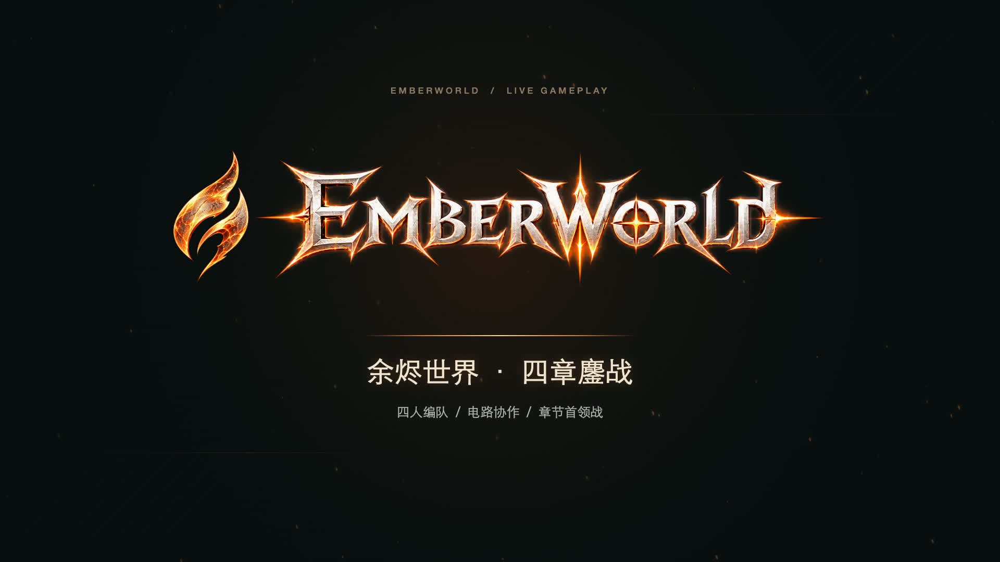
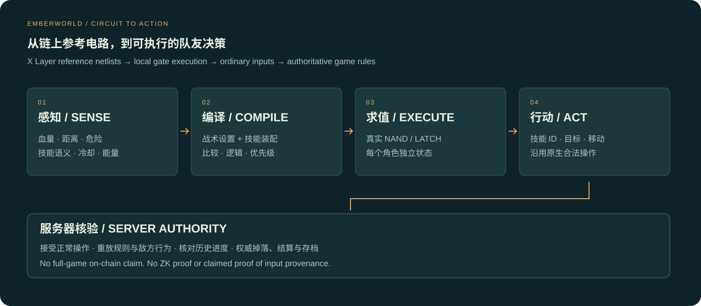
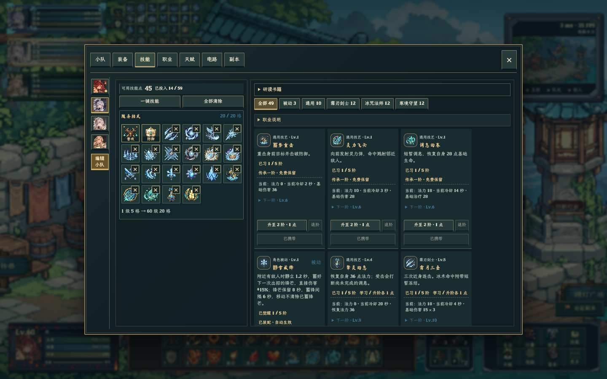
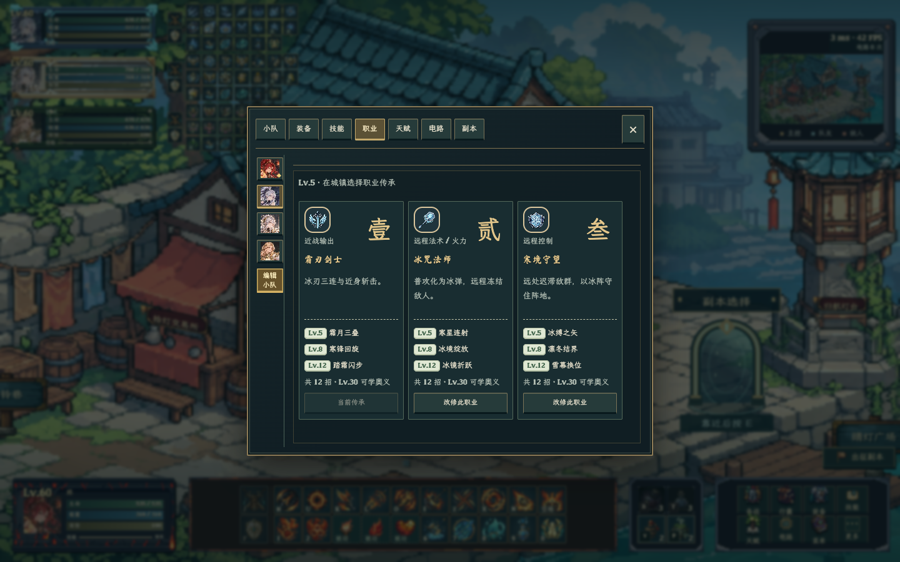
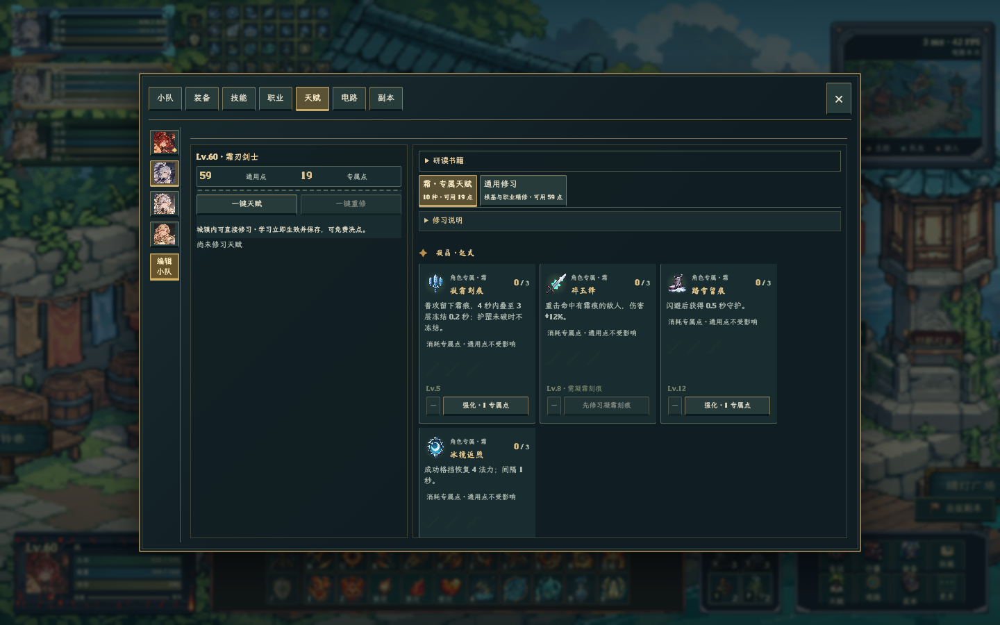
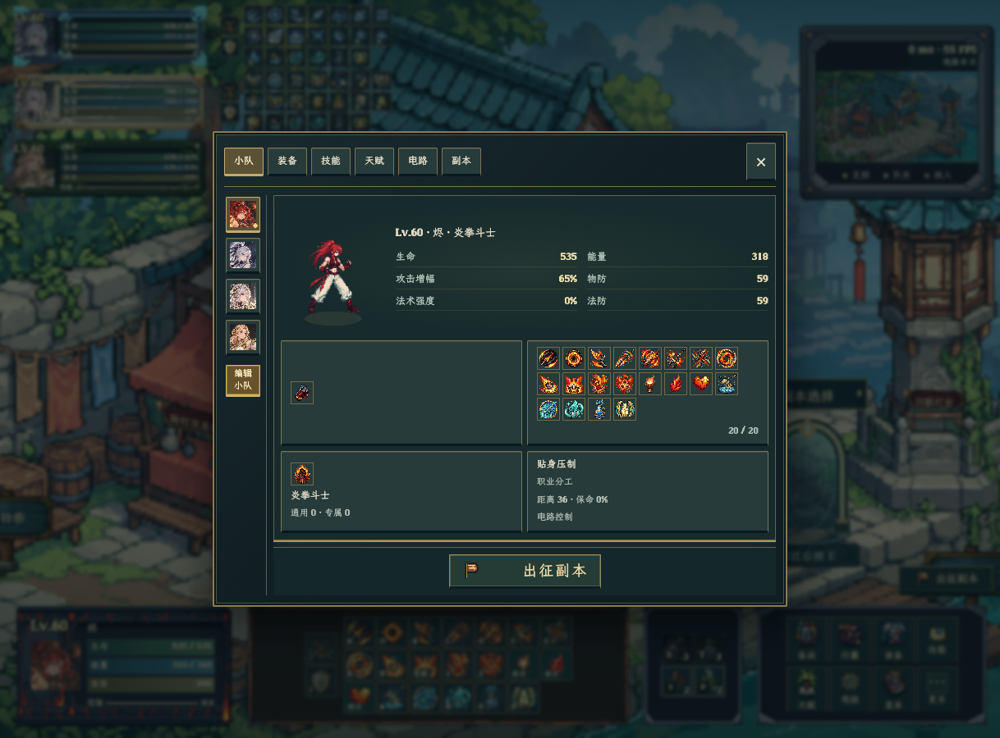
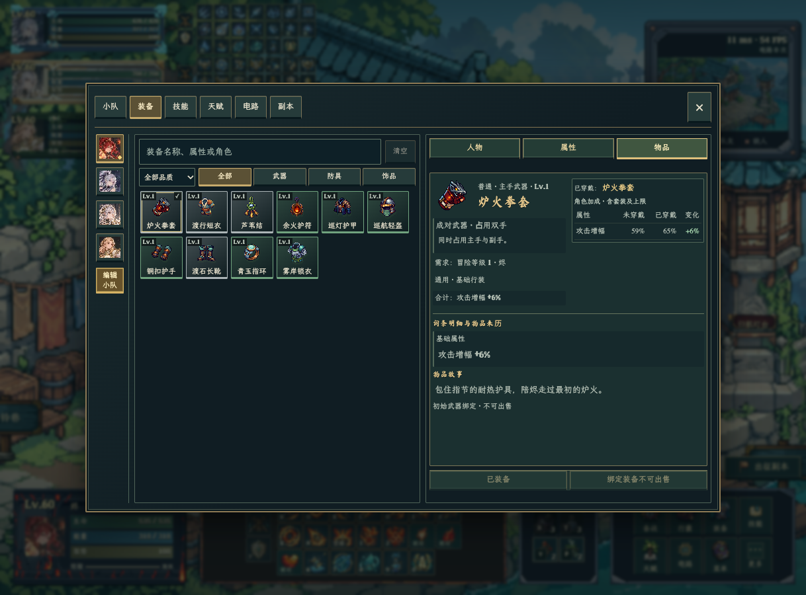
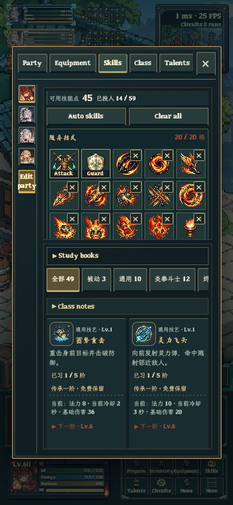
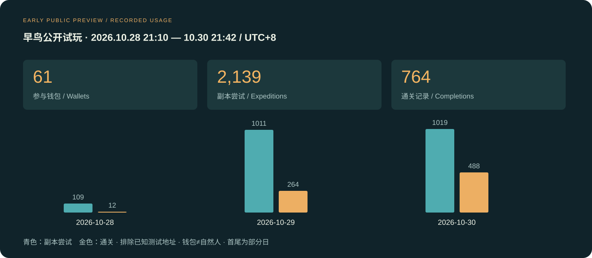

# EmberWorld · 余烬世界

**把电路接成战术大脑，让队友与你一起闯关。**

[English](README.en.md) · [进入游戏](https://emberworld.net/) · [104 秒实机 Demo](media/gameplay-104s.mp4) · [官推](https://x.com/EmberWorldX) · [社区](https://t.me/EmberWorldXLayer)


*品牌概念海报；下方视频与界面图为实际游戏画面。*

EmberWorld 是一款围绕 **X Layer / TapeOut 电路生态**构建的像素动作 RPG。你可以从八位英雄中组建最多四人的小队，探索副本、挑战首领、收集装备，再通过技能、职业、天赋与电路战术调整队伍。电路参与“选择谁、何时靠近、何时躲避、使用哪个技能”等决策，游戏引擎负责执行动作与战斗规则。

这是从《余烬擂台》发展而来的新阶段：由横向对抗走向带空间纵深的探索与协作冒险。**本仓库提交的是世界版的新开发成果，旧擂台保留在[上一期仓库](https://github.com/BensonXBX/ember-tapeout)。**

> 状态快照：2026-10-30。公开入口是有限范围的早鸟试玩；完整备战系统位于测试版。这里公开项目说明、精选电路代码、参考网表与验证示例，不包含完整游戏、服务器或玩家存档。

## 先看真实游戏

[](https://github.com/BensonXBX/EmberWorld/raw/refs/heads/main/media/gameplay-104s.mp4)

**[▶ 播放／下载 1 分 44 秒 Demo](https://github.com/BensonXBX/EmberWorld/raw/refs/heads/main/media/gameplay-104s.mp4)** — 四人混战、技能组合与首领交锋；完整 HUD、原速录制、统一游戏配乐。视频来自 10 月 28 日独立测试存档，保留当日 UI；本仓库另展示 10 月 30 日更新后的备战界面。网页预览不能播放时可下载 MP4。不是 CG、不是链上逐帧运行，也不是实时在线玩家录像。

## 新一轮做了什么

| 方向 | 上一期《余烬擂台》基线 | 本期《余烬世界》新增 |
|---|---|---|
| 游戏形态 | 横向格斗、单人电路挑战、PVP | 带空间纵深的副本探索、四人协作、怪群与首领战 |
| 电路控制 | 擂台动作引脚与连招逻辑 | 世界专用感知接口、目标选择、支援／保命／导航意图、动态技能装配适配 |
| 玩家成长 | 单局对战为主 | 装备掉落与配装、技能学习／装配、职业和天赋、持久进度 |
| 网络架构 | 联机房间与对战服务 | 本地完整推演、服务器滚动核验、权威掉落／结算／存档、断线恢复 |
| 界面 | 擂台首页与选人 | 小队 → 装备 → 技能 → 职业 → 天赋 → 电路 → 副本，电脑与手机适配 |
| 运营 | 对战与周榜记录 | 副本记录、玩家行为汇总、性能与客户端恢复监控、测试／公开环境隔离 |

本期活动自 10 月 16 日开始；世界版的早期探索始于 10 月 14 日，**这里只把活动期间完成的集成、界面、运行架构和公开试玩列为本期增量**。见[开发时间线与交付状态](docs/PROGRESS.md)。

## 电路真的在驱动角色



1. **感知**：适配层从游戏状态读取血量、能量、距离、危险区域、技能冷却和可达位置，编码成电路输入。
2. **编译**：战术设置与当前技能配置被编译为模块连接图。比较器、与／或／非、选择器、优先编码器、译码器及有状态模块共同构成大脑。
3. **执行**：浏览器实际逐门运行 FabX 参考网表的 NAND / LATCH；每个角色实例拥有独立状态。
4. **行动**：输出映射为移动、闪避、支援、交互、技能 ID 与目标 ID等正常操作。伤害、冷却、碰撞、资源和掉落不由电路任意改写。
5. **核验**：服务器按接受的操作运行规则并核对历史进度，负责最终结算与保存。

**它理解的是技能语义和条件，不是固定轮流按 J/K/L。** 把治疗技能换到另一格，运行时重新绑定技能 ID、效果、射程、资源与冷却，编译后的输出仍指向治疗。伤害技能不会因为一个输出位为 1 就跳过原生施法条件。

当前使用 **9 类 X Layer FabX 官方参考电路**：`#1 #3 #4 #9 #21 #29 #30 #46 #47`。参考电路容器为 [`0x265e2580cb9c3fc059f2aa3cf20ad30f3f0a653c`](https://www.oklink.com/xlayer/address/0x265e2580cb9c3fc059f2aa3cf20ad30f3f0a653c)，对应 Circuit ID 与上述编号一致。完整来源、固定区块、网表 SHA、引脚、用量解释和代码路径见[电路技术说明](docs/CIRCUITS.md)。

**实现边界说清楚：** 当前已经运行真实参考网表；“扫描玩家钱包中的 FabX 矿机、按持有的网表装配大脑”仍属于下一步接入。多个模块复用一种电路，不等于需要购买同样数量的 NFT。这里没有 ZK 证明，也不声称能证明每条输入一定来自指定电路。

### 评委可以直接验证

```sh
git clone https://github.com/BensonXBX/EmberWorld.git
cd EmberWorld
npm test
npm run demo
```

Node.js 22+，无需安装依赖、钱包或 RPC。**15 项测试通过，覆盖 9 类参考电路的 2,304 条记录向量**、原始网表哈希／解码一致性、治疗位置变化、危险闪避、冷却限制、独立记忆和目标优先级。

示例实际输出：正常时 `strike`，低血量时 `heal`，危险到来时 `dodge`。这是可复现的合成输入实验，不把它当成完整游戏通关证明。

## 最新备战体验


*10 月 30 日测试版：每位英雄独立配置，最多 20 个可装备技能格；普攻和防御是另外两个固定动作。*

| 职业分支 | 天赋成长 |
|---|---|
|  |  |

| 小队概览 | 装备与属性对比 |
|---|---|
|  |  |

<details><summary>查看手机界面与截图口径</summary>



这些是与 07 研究版对应的界面代码在本机浏览器验证时的真实渲染截图，使用独立构造的测试角色／存档。它们展示界面与功能，不代表公开服玩家等级、资产或全部功能已经开放。小队／装备图早于同日“职业独立分页”的最后调整。更多见[媒体说明](docs/MEDIA.md)。

</details>

## 公开试玩的实际反馈

**61 个参与钱包 · 2,139 次副本尝试 · 764 次通关记录**



统计窗口：**2026-10-28 21:10 至 2026-10-30 21:42:24，UTC+8**。来自公开服副本摘要，排除沙盒、研究服和统计时已知运营／测试名单；同一钱包去重，副本按记录 ID 去重。钱包不等于自然人，重试不是新增玩家，未完成记录不算通关。这里只是约两天的早鸟数据，不能据此推断留存、付费转化或服务器容量。明细事件存在有界丢弃，见[统计口径及局限](docs/TRACTION.md)与[匿名汇总 JSON](data/traction-2026-10-30.json)。

## 为什么玩家会来，又为什么会回来

- **动作与刷宝玩家**：想体验四人协作、技能组合、配装和首领挑战，得到持续可改进的队伍。
- **TapeOut / FabX 建设者**：希望电路不只停留在参数与排行榜，而能产生可观察、可对比的游戏行为。
- **策略玩家与创作者**：通过角色、装备、技能和战术形成组合，分享实机、复盘路线与大脑方案。

我们希望形成“探索 → 获得装备和进度 → 调整队伍与电路 → 挑战更难副本”的循环。Pass 提供电路玩法使用资格与身份，价值来自持续更新和实际体验。计划中的外观、赛季内容、挑战活动等须随实际开放公布；**不把持卡收益、分红或代币价格上涨作为产品承诺**。详见[玩法、用户与商业模式](docs/GAMEPLAY-AND-MODEL.md)。

## X Layer / TapeOut Accelerate 对照

| 要求 | 本项目如何满足 |
|---|---|
| 使用 X Layer 上的电路、合约或数据 | X Layer 196 的 FabX 参考网表进入真实控制链路；链上 Pass 资格由服务端核验 |
| 说明哪些功能使用电路 | 目标仲裁、条件判断、技能选择、记忆和行动意图；界面、几何寻路、物理与结算由常规代码负责 |
| 可复用现有处理器 | 使用现有官方参考电路容器，附地址、Circuit ID、区块和验证材料；没有把它声称为自部署处理器 |
| 目标用户／真实需求／收入模式 | 面向协作刷宝与电路策略玩家；Pass 玩法授权及后续内容商业化方案，分清已实现与规划 |
| 已有项目需实质新增 | 单列活动期间的世界版开发，与上一期擂台区分；不把旧成果全部计为本期新增 |
| 可访问应用与演示 | 游戏入口、测试版状态说明、104 秒实机、独立可运行的电路测试 |

完整证据索引见[参赛要求与材料](docs/SUBMISSION.md)。当前早鸟试玩有 Pass／容量／进度限制，不要求评委为了审阅而购买资产；视频与代码可直接评审，如需完整实机权限请联系团队安排测试入口。

## 团队与下一步

**Benson**：产品与 UI、服务框架、Web3 对接、电路组合与运行、数据与部署。**[@anopened1](https://x.com/anopened1)**：游戏本体、战斗、角色与场景内容。上游本体与集成框架按边界合并，避免界面或联网改动悄悄改变战斗数值。

接下来重点：完善手机长时间运行与恢复稳定性、继续验证完整成长系统、接入玩家实际持有的电路网表、提供更直观的战术编辑与对比。装备 NFT、市场流通、FAB 消耗和赛季活动需逐项验证后开放，不代表当前已上线。

| 入口 | 地址 |
|---|---|
| 游戏 | https://emberworld.net/ |
| 研究版 | https://emberworld.net/research/ |
| 官网 / DeWeb 项目介绍 | https://1-2-300.tapekit.org/ |
| 官方 X | https://x.com/EmberWorldX |
| 社区 | https://t.me/EmberWorldXLayer |
| 项目发展长文 | [余烬未熄：从黑神话到余烬世界](https://x.com/EmberWorldX/status/2113620000657527060) |

[架构与信任边界](docs/ARCHITECTURE.md) · [开发进度](docs/PROGRESS.md) · [媒体与版本说明](docs/MEDIA.md) · [代码与素材权利说明](NOTICE.md)
