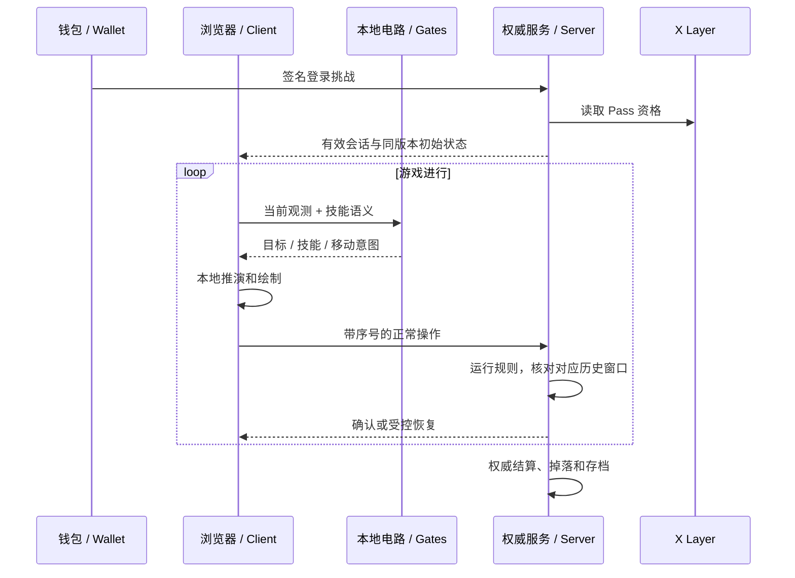

# 架构与信任边界 / Architecture

## 分层

| 层 | 所在位置 | 负责什么 |
|---|---|---|
| 界面与表现 | 浏览器 | 像素场景、人物动画、技能栏、编队与备战、手机适配 |
| 本地推演 | 浏览器 | 同版本战斗推演与即时操作反馈 |
| 电路决策 | 浏览器 Worker／本地运行模块 | 观测 → NAND/LATCH → 正常行动输入 |
| 权威核验 | 游戏服务 | 接受合法输入、独立运行战斗规则与敌方行为、匹配历史进度 |
| 资产与存档 | 服务端与必要链上读取 | 掉落、装备、成长、结算、保存、钱包会话与 Pass 资格 |
| 运营观测 | 独立管理服务 | 性能、战斗摘要、筛选分页、恢复异常与访问安全 |

## 为何采用服务器验算

客户端即时反馈能减少高延迟网络对每一次动作的影响；服务器核对对应的历史步骤，而非不断把当前画面拉回旧状态。核验发生分歧时进入恢复流程，正常网络波动与确定性计算问题不能直接等同作弊。服务器仍承担战斗规则和最终结果，不能把客户端上报的伤害、装备、金币或“已通关”直接存为事实。

签钱包只验证身份，不能证明用户浏览器没有被修改。当前方案也不证明每个输入来自某张指定电路；输入来源证明与游戏规则权威是两个独立问题。

## 已知限制

- 浏览器必须拿到所运行的规则与场景，不能承诺源码、怪物信息或状态完全保密。
- 当前未实现 ZK 电路执行证明、全链战斗、无信任客户端或完全不可预测的奖励系统。
- 手机 OKX WebView 的长时白屏／页面重载仍在排查；浏览器模拟检查不能替代真实手机长期验证。
- 重启服务不等于完整战斗无缝续接；确认进度保存与原地续战要分别验证。
- 独立后台、公开服和测试服减少发布干扰，但仍共享物理资源；不能宣称修改后台永远没有资源影响。
- 试玩准入上限不是经过压测证明的并发容量。

游戏网页与 DeWeb 交付也不同：历史《余烬擂台》已有 DeWeb 交付，世界版当前使用在线权威服务。独立官网可以由 DeWeb 承载；**不能因此称世界版后端、存档与全部战斗在链上运行。**

### English

Local simulation provides immediate feedback. Local gates produce ordinary inputs; the authoritative service executes combat rules, validates matching historical windows, and owns final persistence and rewards. Wallet signatures authenticate an identity, not an untampered client. No ZK execution proof or trustless combat is claimed. Public/research/admin releases are separated but share hardware. Mobile WebView stability remains an active investigation. DeWeb publication of a site or the earlier Arena does not make the current World backend on-chain.
