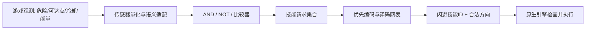

# 真实网表如何成为队友大脑 / Circuit execution

## 可核对的来源

- 网络：X Layer，chain ID `196`。
- 参考电路容器 / processor：`0x265e2580cb9c3fc059f2aa3cf20ad30f3f0a653c`。
- FabX PoD mining：`0x4f6a2312d80753bdafd35ddb1bf4bb14c43f8265`。它与参考电路容器不是同一地址。
- 固定块：`73,742,631`；block hash `0x24f18e50517d4727d94f759985511d50c161a8d17c25177c1f59f814091b057c`。
- 抓取时间：2026-10-20 23:54:42 UTC+8。这里是已保存的固定块证据，不是实时最优／矿机权属查询。
- 当时从 FabX 官方 tasks/taskbank 取得题目映射，以固定块读取题目参考容器及网表，并核对引脚、周期与向量 root；本仓库只导出实际用到的 9 类。
- 官方题目接口：https://api.fabx.tech/v1/pod/tasks?chainId=196；向量接口示例：https://api.fabx.tech/v1/pod/tasks/21/vectors?chainId=196 。

`data/reference-boards.json` 保留 processor、Circuit ID、原始 netlist 字节、SHA-256、解码 ops、向量 root 与固定块。`data/vectors/` 为记录的官方向量输入输出。测试核对原始字节 → ops → 实际求值，**未包含 Merkle 证明验证或新发起的链上读取**。

| FabX 题目 / Reference Circuit ID | 功能 | 输入→输出 | NAND | LATCH | 大脑用途 |
|---|---|---:|---:|---:|---|
| 1 | 单比特反相器 / NOT | 1→1 | 3 | 0 | 取反条件 |
| 3 | 双输入与门 / AND | 2→1 | 4 | 0 | 多项条件同时成立 |
| 4 | 双输入或门 / OR | 2→1 | 5 | 0 | 条件合并 |
| 9 | 二选一选择器 / MUX | 3→1 | 6 | 0 | 比较后的候选与目标路由 |
| 21 | 二位无符号比较器 | 4→3 | 32 | 0 | 级联判断血量、能量、距离及目标分数 |
| 29 | 复位优先同步 SR 位 | 3→1 | 11 | 1 | 低血量撤退与恢复参战之间的记忆 |
| 30 | 自主翻转状态位 | 0→1 | 3 | 1 | 产生决策节奏／交互脉冲 |
| 46 | 八路低位优先编码器 | 8→4 | 63 | 0 | 多个技能请求的优先仲裁 |
| 47 | 带使能三到八译码器 | 4→8 | 59 | 0 | 将胜出编号解码成动作请求 |

这些是**参考设计**的门数，不是每题最优门数；题目编号也不能直接替代其他链的 TapeOut 题号。

## 从“看见危险”到“闪避”

适配层负责提供可信形状的数据与可走位置候选。电路决定是否需要躲避、撤退、接近或支援；原生寻路计算路线，原生游戏判断技能是否真的能释放。不是把全部 JavaScript 算术、寻路与渲染伪装成电路。

技能接口允许 **20 个装备槽＋普攻／防御两个固定动作**。`loadoutPolicy()` 读取每个技能的实际 ID、效果、配置和优先级。冷却结束只是必要条件之一；还要看射程、血量／治疗对象、能量余量、危险、已有增益和队伍指令。更换装配或技能等级时，控制器签名变化会触发重新编译。

目标大脑对最多 8 个已筛选候选进行电路比较，支持职业倾向、最近、低血量、施法者等偏好。候选收集与几何距离在适配层完成；最终候选间的优先比较由网表执行。预设是可解释的策略，不是神经网络训练或全局最优解。

## 每块网表如何计算

`Circuit.run()` 按原始 ops 执行：NAND 输出 `1 - (a & b)`；LATCH 先读取本周期旧状态，全部门求值后统一提交下一状态。每个实例都有独立 `state`，不会串用另一位英雄的记忆。组合模块按拓扑次序运行；跨模块非法反馈被拒绝，内部时序由 LATCH 表达。

实例数、门运算次数、题目类别数、NFT 持有数是四种不同概念。示例的三技能战斗脑有 653 个模块实例、3,915 个 NAND、2 个 LATCH；加上目标脑共 956 个实例。**这只是示例编译结果，真实装配会改变数量，不能据此声称玩家必须购买 956 张 NFT。** 当前引用参考网表的经济授权规则尚未等同于未来钱包矿机方案。

## 可审阅代码

| 文件 | 内容 |
|---|---|
| [circuit.mjs](../src/circuits/circuit.mjs) | 网表验证、实际门求值、LATCH、图执行与向量测试 |
| [world-interface.mjs](../src/circuits/world-interface.mjs) | 世界版传感器／动作 ABI，与擂台接口分离 |
| [world-logic.mjs](../src/circuits/world-logic.mjs) | 将逻辑表达编译为具体题目模块接线 |
| [world-brain.mjs](../src/circuits/world-brain.mjs) | 战斗与技能语义策略编译 |
| [world-target-brain.mjs](../src/circuits/world-target-brain.mjs) | 目标选择网表 |
| [world-demo-model.mjs](../src/circuits/world-demo-model.mjs) | 配置校验、控制器与模块实例统计 |
| [world-adapter.mjs](../src/circuits/world-adapter.mjs) | 真正的观测与正常游戏操作映射 |
| [runtime.mjs](../src/circuits/runtime.mjs) | 逐角色控制、装配变更重编译、原生几何接入 |

这 8 个模块是 2026-10-30 集成源码的精选原样副本，未包含完整引擎。前 6 个和数据可直接运行示例；adapter/runtime 需要由游戏宿主提供原生几何、技能、角色与状态接口，不应当作独立游戏启动器。

## 信任与未完成边界

NAND 计算发生在用户浏览器，避免每次战术判断产生链上交易。服务器接受经过合法性约束的正常操作并执行规则，**没有密码学证明输入必然来自特定网表**。不能把“确实执行电路”扩大成“客户端不可修改”或“全链游戏”。

当前上线的是固定参考目录＋编译配置；玩家持有矿机的枚举、网表资格与兼容性校验、替换加载、付费规则仍需产品与实现闭环。功能完全等价、状态／引脚相同的优化网表，理论上应保持动作输出；改变行为的是接线、策略、状态或接口语义，而不是门数更少就自然更聪明。

### English summary

The selected runtime executes recorded FabX reference NAND/LATCH netlists on X Layer chain 196. The reference container, block and circuit IDs above identify the source; this is not a live ownership or best-design claim. Native code supplies geometry and semantic observations. Gate networks arbitrate targets, movement intent and equipped skills; native rules execute legal actions. Rebinding uses skill IDs and effects, not keyboard positions. Nine circuit types are reused across many isolated instances. The 2,304 recorded vectors and behavioral tests can be run offline. Player-owned miner substitution and cryptographic provenance proofs are not currently implemented.
